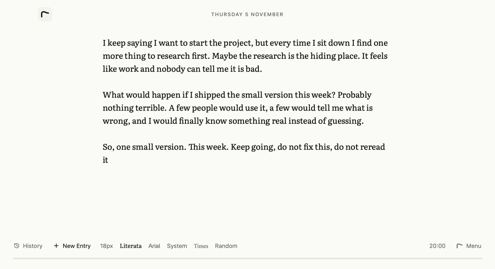
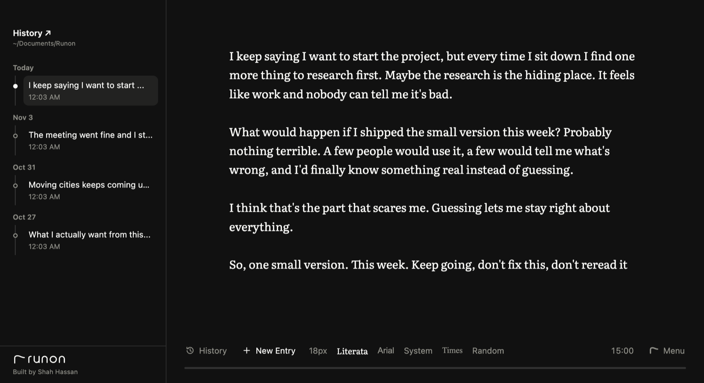

<p align="center">
  <picture>
    <source media="(prefers-color-scheme: dark)" srcset="docs/assets/runon-logo-light-ink.svg">
    
  </picture>
</p>

<p align="center">
  <strong>A quiet place to write without stopping.</strong><br>
  A distraction-free freewriting app for macOS and Windows. Your words stay on your computer.
</p>

<p align="center">
  
</p>

## Why Runon

Most of us edit while we write, and that gets in the way of finding out what we actually think.

Freewriting fixes that with one rule: keep writing for a set time, without going back. Spelling doesn't matter, and neither does whether it's any good. Once you've run through the polished first thoughts, the honest ones start to show up.

Runon is built around that rule. There are no formatting tools or accounts. You open it and start typing.

## How it works

1. Pick something to write about, like a decision, a problem at work, or a new idea.
2. Open **Menu** and click **Fullscreen**.
3. Click the **time**, choose how long you want, and click **Start**. The controls fade away, leaving only your words and a thin line that grows as time passes.
4. Keep writing until the controls fade back in.

Turn **Backspace off** in the menu if you want to make going back impossible.

## Features

- **The line:** a thin line grows across the bottom of the screen as your timer runs. It's the only thing on screen besides your words.
- **Timer:** pick a preset from 5 to 45 minutes or set anything from 1 to 120. Runon remembers your last choice.
- **Backspace off:** blocks the Backspace and Delete keys so you keep moving forward.
- **Autosave:** there's no save button. New entries are ready to write in as soon as you click **New Entry**.
- **The line keeps you going:** stop typing during a timed session and the line slowly fades. It comes back as soon as you type.
- **Session summary:** when the timer ends, Runon shows how much you wrote, like "412 words in 15 minutes".
- **Search:** press Cmd+F (Ctrl+F on Windows) to open a floating search, like Spotlight. Results appear as you type, and arrow keys and Return open them.
- **History:** browse past entries as files, each showing the start of what you wrote, export them as PDFs, or move them to the Trash.
- **Folders:** group entries in History, with folders inside folders as deep as you like. Click a folder to see what's inside, and drag an entry or a folder onto another folder to move it.
- **Chat, if you want it:** after a long session, send an entry to ChatGPT or Claude to talk it through.
- **Your look:** light and dark themes, several text sizes, and Literata, Arial, System, Times, or a random font from your computer.

<p align="center">
  
</p>

## Your privacy

Runon has no accounts, server, or analytics. Everything is saved as ordinary files you can open, back up, or move:

```text
Documents/Runon/
├── [id]-[date].md          one file per entry, in plain text
└── Your folder/            one real folder per group you make
    └── [id]-[date].md
```

A few things to know:

- **Chat is the one feature that sends your writing anywhere.** It only happens when you click it, and your entry is placed in a web link to ChatGPT or Claude, so it may also stay in your browser history. **Copy Prompt** lets you paste it yourself instead.
- **Files aren't encrypted.** Anyone with access to your user account can read them. Turn on FileVault or BitLocker to protect them if your computer is lost.
- **Cloud sync applies as usual.** If your `Documents` folder syncs to iCloud or OneDrive, your entries sync too.

## Install

Installers aren't published yet, so for now you'll need to [build Runon from source](#build-from-source).

| Platform | Requires | Status |
| --- | --- | --- |
| Mac with Intel | macOS 13 Ventura or newer | Tested on macOS 13 |
| Mac with Apple Silicon | macOS 13 Ventura or newer | Not yet tested |
| Windows (64-bit) | Windows 10 or newer | Not yet tested |

Runon is small: about 4 MB installed on a Mac, with a 2 MB installer.

The builds aren't signed with an Apple or Microsoft certificate, so a copy you download from someone else will trigger a warning the first time you open it:

- **macOS:** right-click the app and choose **Open**. If it's still blocked, allow it in **System Settings > Privacy & Security**.
- **Windows:** on the SmartScreen warning, click **More info**, then **Run anyway**.


## Build from source

You need [Node.js](https://nodejs.org) 22 and [Rust](https://www.rust-lang.org/tools/install).

```bash
git clone https://github.com/shahhassan24/runon.git
```

```bash
cd runon
```

```bash
npm install
```

Run the app:

```bash
npm start
```

Build an installer for this computer:

```bash
npm run build
```

For each platform's steps and output files, see the [build guide](docs/BUILDING.md).

| Command | What it does |
| --- | --- |
| `npm start` | Runs the app from source |
| `npm run build` | Builds an installer for this computer |
| `npm test` | Runs the full test suite on a Mac |

The tests run the real app with a temporary folder, so they don't touch your entries, settings, clipboard, browser, or Trash.

## Project layout

```text
ui/                  The interface: HTML, CSS, JavaScript, and fonts
├── app.js           How the app behaves
├── bridge.js        Connects the interface to the native side
└── print.js         Lays out pages for PDF export
src-tauri/           The native side, written in Rust
├── src/main.rs      Files, window, and system features
└── src/pdf.rs       PDF export
build/               Icon and installer art
test/                The test suite
```

The interface is plain JavaScript, HTML, and CSS, with no framework or bundler. Tauri uses the web engine already built into macOS and Windows, which keeps the app small.

## Known limitations

- There are no automatic updates. To update, install a newer build over the old one.
- On Windows, PDF export opens the system print dialog, where you can choose **Microsoft Print to PDF**.
- Text in joined scripts, like Urdu or Arabic, looks right in exported PDFs but may not copy out of them correctly.
- Apple Silicon and Windows builds haven't been run on real hardware yet. If you try one, please [open an issue](https://github.com/shahhassan24/runon/issues) and say how it went.

## Credits

Built by **Shah Hassan**.

Runon began as a rebuild of [Freewrite](https://github.com/farzaa/freewrite) by Farza Majeed, and its core idea and features come from there. The ChatGPT and Claude prompts also come from Freewrite.

## License

[MIT](LICENSE). The bundled Literata font is under the [SIL Open Font License](ui/fonts/OFL.txt).
